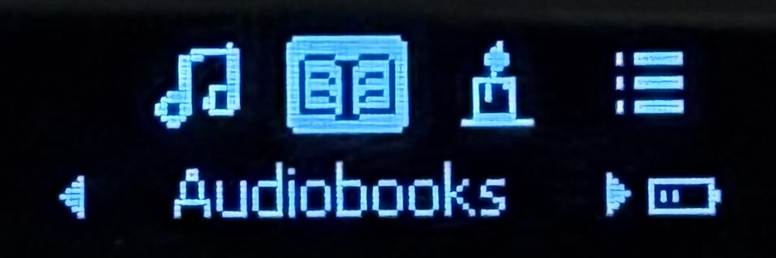
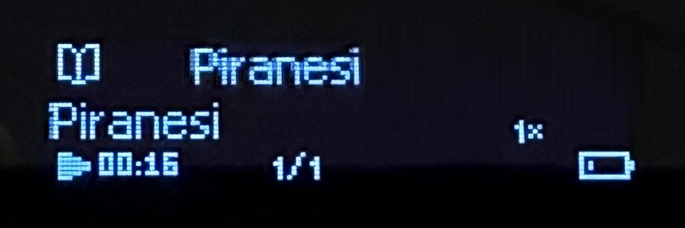

# FiiO Echo Nano custom firmware

> [!CAUTION]
> **Use at your own risk. I take no responsibility for what happens to your
> device.** This is unofficial, experimental firmware. Building, flashing or
> using it can brick your Echo Nano, lose the data on it, void its warranty,
> etc. So can a mistake while following these instructions. A firmware that does
> not boot may not be recoverable. If you go ahead, you accept all of the risk.
> The software is provided "as is", without warranty of any kind; see
> [LICENSE](LICENSE).

Audiobook and meditation features for the FiiO Echo Nano, built on
[NaniteCFW](https://github.com/maaraneasi/nanitecfw) by Marek Pleskac. This
repository contains only patches and build tools. It does **not** contain FiiO's
firmware: you download the official image yourself and turn it into the custom
image on your computer.

Not affiliated with or endorsed by FiiO. FiiO and Echo Nano are trademarks of
their owners.

> **Status: experimental.** Individual features have worked on the author's
> device, but no build has passed full hardware acceptance. After some updates
> the player hung or looped at startup until it was restarted by hand; the cause
> is not confirmed. An earlier candidate (P4a) boot-looped and needed a USB
> Loader restore. Read [Recovery](#recovery) before flashing.

**Tested on:** Echo Nano hardware 1.0.0 with the official firmware **V1.7.0**
only. The build refuses any other stock image.

<p>
  
  
</p>

The main menu with the new Audiobooks entry, and an audiobook playing (photos
from the author's device).

## Features

### Added by this fork

| Feature | On the author's device |
|---|---|
| **Audiobooks** and **Meditations** in the main menu, for folders marked with an empty `.audiobook` or `.meditation` file | works |
| **Book playback** in `BOOK.M3U` chapter order, with the position saved per book | works |
| **Continue *book*** at the top of Audiobooks reopens the last book | works; after a restart not yet confirmed |
| **Bookmarks**: save while listening, then jump back from the player menu or the book menu | saving works |
| **Speed** for MP3 books, about 1×–2×, from the player menu and remembered per book | works; per-book memory not yet confirmed |
| **Ten-second seek** with Previous/Next while a book plays | works |
| **Long books**: hours on Now Playing; progress saved every five minutes | hours work; autosave not yet confirmed |
| **Book screen**: book and chapter titles on Now Playing | not yet confirmed |
| **Natural folder sorting** (CD1, CD2 … CD10) in browser lists and folder playback | list order works; playback order not yet confirmed |
| **Automatic book preparation**: the player creates missing playlist and state files for simple book folders | not yet confirmed; [`tools/prepare_book.py`](docs/audiobooks.md#prepare-books-on-a-computer) does it on a computer |
| **Music Library** leaves out marked book and meditation folders; File Browser playback stays inside the selected folder | not separately confirmed |
| Shorter Back and Home holds; full-width lists and settings menus | not separately confirmed |

### From upstream NaniteCFW 6.0.5

| Feature | Upstream status |
|---|---|
| **Faster library refresh**: about 5× faster on a FLAC-heavy card (148 s → 28 s for 2,000 songs) | tested on device |
| **Recent Albums** in Media Library: all albums, newest first, by the date the album's folder was created | tested on device |
| **Shuffle** in the main menu: shuffle play over the whole card in one press | tested on device |
| **Shuffle scope**: Shuffle Play covers the whole card instead of the current folder | tested on device |
| **Unsupported tracks** are skipped without a popup; playback stops after 10 failures in a row | tested on device |
| **Album Artists / Artists**: the stock Artists list, which groups by album artist, is renamed "Album Artists"; a new "Artists" list groups by each track's own artist | tested on device |
| `CFWLOG.TXT` in the card's root after each refresh: timings and counters | tested on device |
| **Power saving**: lower CPU clocks during playback, CPU sleep with the screen on, slower scroll-wheel polling | **off in this fork**; see the [community patch review](docs/community-patches.md) |

The upstream status is upstream's own testing. Upstream changes after 6.0.5
(commit `ea4e6dc`) are not included.

## Download a release

The quickest way needs only Python 3.10 or newer:

1. Download the official V1.7.0 `NANOV170.IMG` from
   [FiiO's firmware page](https://forum.fiio.com/note/showNoteContent.do?id=202605161533005115232).
2. Download the patch ZIP from
   [Releases](https://github.com/pkronstrom/echo-nano-audiobooks/releases) and
   check it against the SHA-256 listed there.
3. In the extracted folder, run:
   ```sh
   python3 apply_release.py --input /path/to/NANOV170.IMG --output ./nano-ready
   ```
   This writes the custom firmware to `nano-ready/custom/NANOV170.IMG` and the
   recovery image to `nano-ready/recovery/NANOV170.IMG`.

The ZIP contains only the changed bytes, not FiiO's firmware, and the script
refuses any other stock file. The README in the ZIP explains how to choose a
build date. Then continue with [Install](#install).

## Build your own firmware

### Requirements

1. The official Echo Nano **V1.7.0** firmware file `NANOV170.IMG`, from
   [FiiO's firmware page](https://forum.fiio.com/note/showNoteContent.do?id=202605161533005115232).
   The build checks its SHA-256 and refuses any other file:
   `54a45d233a23c3ce142d1da9c093cc40c46eba417aa91fe915ee867726f4a116`.
   Other firmware versions are **not** supported: the patches are written for the
   exact code addresses of V1.7.0.
2. GNU make 4.3 or newer and Python 3.10 or newer.
3. The Arm GNU toolchain (`arm-none-eabi-gcc`). Every image of this fork tried
   on a device was built with **Arm GNU Toolchain 13.2.Rel1** (gcc 13.2.1). Use
   that version: it reproduces the author's images byte for byte. The build stops
   if the code no longer fits its memory limits, but images from other compiler
   versions have not been tried on a device.
   - macOS: `brew install make python`, then download 13.2.Rel1 from
     [Arm](https://developer.arm.com/downloads/-/arm-gnu-toolchain-downloads)
     and put its `bin` directory on your `PATH`. Use **`gmake`** instead of
     `make`: the system make is too old.
   - Debian or Ubuntu: `sudo apt install make python3 gcc-arm-none-eabi`, then
     check the version with `arm-none-eabi-gcc --version`.
   - Nix: `nix-shell` in this directory provides everything; the toolchain
     version follows your nixpkgs.
4. Optional, for `make test`: FFmpeg and `python3 -m pip install unicorn==2.1.4`.

### Build

```sh
cp ~/Downloads/NANOV170.IMG .            # the official V1.7.0 image
make check                               # confirms it is the expected stock file
make audiobook AUDIOBOOK_DATE=20261101   # builds the custom and recovery images
make test AUDIOBOOK_DATE=20261101        # optional checks; rebuilds with the same date
```

This writes two images:

- `out/audiobook/NANOV170.IMG`: the custom firmware. Its About screen shows **P4e**.
- `out/audiobook/recovery/NANOV170.IMG`: FiiO's unmodified code, dated one day
  later. Keep it for [Recovery](#recovery).

To check that your toolchain produces the same binary as the author's latest
test build, build once with `AUDIOBOOK_DATE=20261122`. The SHA-256 of
`out/audiobook/NANOV170.IMG` should then be
`84f78dea227b030734c34f2eae8398efe354040ca36f35592e1782bd63e74b67`. Build again
with your own date before you flash.

`AUDIOBOOK_DATE` (default `20261013`) is the build date stored in the image. The
player installs and boots the firmware with the **newest** date, so the date must
be newer than the firmware already on your player (stock V1.7.0 is dated
2026-08-24), and every image you flash after it must be newer again. Don't pick a
date far in the future: an official FiiO update dated earlier than your custom
build would be ignored.

`make test` rebuilds the images, so pass it the same date. Passing tests do not
mean that a build boots: P4a passed 145 checks and still boot-looped on hardware.

Plain `make` builds `out/NANOV170.IMG` with upstream's features and this fork's
Music Library separation, but without the audiobook features. Its date is `DATE`
(default `20260829`), and `make recovery` builds the matching stock image.

## Install

1. Get both images from a release or your own build, and keep the recovery image
   on your computer.
2. Connect the Echo Nano by USB and copy the custom `NANOV170.IMG`
   (`nano-ready/custom/` from a release, `out/audiobook/` from a build) to the
   root of its **internal** storage, not the SD card.
3. Eject it safely and restart the player. It shows an update screen while it
   installs, then the menu.
4. Check that **About** shows P4e.
5. Set up your card: add the `.audiobook` and `.meditation` marker files and
   prepare your books. See [audiobook setup](docs/audiobooks.md).
6. Run **Media Library → Media Library Refresh** once: Recent Albums and Artists
   need data the stock refresh doesn't write.

## Recovery

**If the player still boots**, copy the recovery `NANOV170.IMG`
(`nano-ready/recovery/` or `out/audiobook/recovery/`) to its internal storage the
same way and restart. It is FiiO's code with a newer date, because the player
ignores the original file while a newer custom build is installed. If you have
flashed an image dated later than that recovery image, make a newer one first:
run `apply_release.py` again with a later `--date`, or run
`make recovery DATE=YYYYMMDD`, which writes `out/recovery/NANOV170.IMG`.

**If it does not boot**, copying a file will probably not help. Installing the
custom image replaces both firmware copies on the player, so there is no
automatic fallback. The author recovered a boot-looping build once through the
Rockchip USB loader mode (USB ID `2207:262d`) with low-level tools; that is not a
reliable or documented procedure. Holding Power for about 10 seconds forces a
restart; it does not switch the player off. Read the
[recovery lessons](docs/recovery-lessons-2026-10-14.md) before you try anything.

The patches do not change the bootloader.

## Known issues

### This fork

- After some updates the player hung or looped at startup until it was
  restarted by hand. The cause is not confirmed.
- Speed control works only with MP3. Other formats play at normal speed;
  `tools/prepare_book.py` can convert a book to MP3.
- Automatic preparation handles only simple book folders on some card layouts;
  other books need `tools/prepare_book.py`.
- Folder playback holds at most 256 audio files and refuses larger folders.
  After a restart, select a track again to get natural order back.

### Upstream

- Back from the new **Artists** list lands on **Album Artists**, and Back from
  **Recent Albums** lands on **Albums**.
- Both artist lists use the same list type internally. If a song plays from one
  of them and you pick the song at the same position in the other, the player
  reopens Now Playing instead of starting the new song.
- FLAC files tagged only with `ALBUM ARTIST` or `ALBUM_ARTIST` (instead of
  `ALBUMARTIST`) are grouped by track artist in Album Artists. This is stock
  behaviour.
- Playback can freeze on some files that show "Format Not Supported!". The cause
  is not found yet.
- Shuffle order is not kept across power cycles.

## How it works

The image is the stock firmware with patched bytes, a recomputed CRC and a new
date. Everything is applied at build time from three kinds of input:

- `patches/*.patch`: data patches, written at a runtime address inside a
  firmware module, or as UI strings by ID and language:
  ```
  32:0307cf14:u"6.0.5"                 # module 32, UTF-16 string + NUL
  22:030794f4:0a21                     # raw hex bytes
  lang:87:en:u"Recent Albums"          # UI string 0x87, English
  ```
- `patches/*.S`: small Thumb-2 code patches, each assembled at its target address
  (`@ patch MOD ADDR`; see `patches/examples/template.S` and `patches/fw.inc`).
- `src/`: C code that runs from free RAM during the media-library refresh
  (faster tag reading and sorting, Recent Albums and Artists tables, the log).
  `src/hooks.txt` lists the firmware calls redirected into it.

`tools/rknano_fw.py` reads and writes the RKNano image format (`info`, `crc`,
`check`, `patch`); `tools/build_blob.sh` builds the C code; `tools/asm2patch.sh`
assembles the `.S` patches.

The audiobook build adds two more parts. `playback/` is C code that stays
resident in free RAM and handles playlists, resume, bookmarks and speed; its
hooks into the native player are in `playback/hooks/`. `browser_sort/` runs in
the file browser's overlay and handles folder sorting and book preparation.
`tools/build_audiobook.py` checks the memory layout and adds both to the image.

### Image format

| Offset | Content |
|---|---|
| `0x000` | u16 year, u16 monthday (BCD build date). Loader boots the valid flash slot with the newest date |
| `0x010` | `"Rockchip"`, `0x030` `"RKnano SDK 1.0"` |
| `0x070..0x150` | resource section table (offset/length pairs) |
| `0x1F4` | firmware length, `0x1F8` `"RKnanoFW"` (checked by the loader) |
| `0x200` | module table: `load_base`, `count`, then 8-word entries `code_load, code_exec, code_len, data_load, data_exec, data_len, bss_exec, bss_len` |
| `0xF8C` | module 0 (resident kernel) at `0x03050000`; overlay modules (UI screens, services) are swapped in at `0x03078ab0..` |
| `0x15212C` | sysdefault · fonts · codepage · lang (21 languages) · images |
| `fw_len` | copy of the `0x200` header, compared with sector 0 by the loader |
| `end-4` | Rockchip CRC32 (poly `0x04C10DB7`, MSB-first, init 0) over everything before it, LE |
